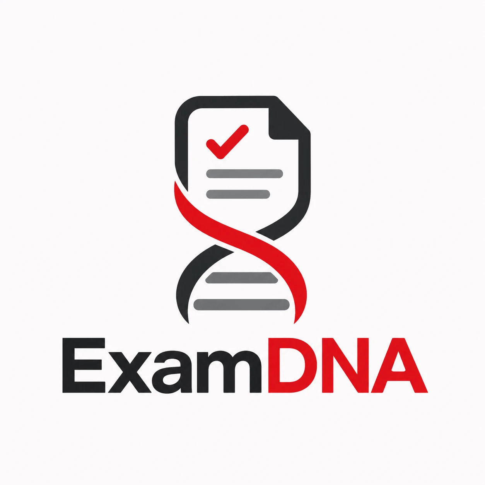
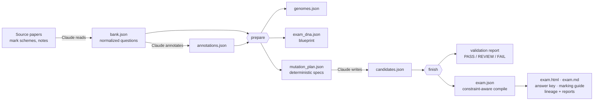

<p align="center"></p>

# ExamDNA

[](https://github.com/mkkirik/ExamDNA/actions/workflows/tests.yml)

**Reverse-engineer exams. Mutate questions. Compile new assessments.**

ExamDNA is an open-source [Agent Skill](https://docs.claude.com/en/docs/claude-code/skills) plus a dependency-free Python engine. You give Claude past papers (and optionally mark schemes, a syllabus, notes); ExamDNA turns them into an explicit **assessment blueprint**, represents every question as a structured **question genome**, plans **controlled mutations** with named operators, **validates** every generated question with deterministic checks, and **compiles** a new exam that satisfies hard mark/section constraints — with an answer key, marking guide, lineage and honest reports.

> ExamDNA is a practice and assessment-design tool. It does not predict real exam questions, is not affiliated with any examination board (IB, AP, Cambridge, Pearson, …), and generated exams are not official.

---

## Why

"Upload notes → ask an LLM for a similar exam" usually loses the exam's structure, guesses difficulty, paraphrases existing questions, overweights some topics, and ships unchecked answers with impressive-sounding but unverifiable numbers.

ExamDNA makes each step explicit and inspectable:

| Typical LLM generation | ExamDNA |
| --- | --- |
| Structure imitated by eye | Blueprint computed from the papers (sections, marks, topics, cognitive demand) with evidence IDs and an evidence level |
| "Write a similar question" | Named mutation operator + machine-made spec of what must change and what must be preserved |
| Answers unchecked | Answers recomputed (exact fractions where possible), units dimension-checked, constraints and invariants verified |
| Paraphrases slip through | Near-verbatim copies and near-duplicates rejected |
| Mark totals drift | Exact-sum constraint solver; infeasible requests explained with alternatives |
| Unexplained "similarity %" | Six separate, documented distance dimensions; no invented scores |

## Pipeline



Rectangles are files; hexagons are deterministic engine steps. Claude does the semantic work (reading, tagging, writing questions, explicit judgements); Python does everything that can be checked. The two talk only through JSON with schemas.

## Core capabilities (v0.1.0)

- **Exam DNA analyzer** — per-paper and aggregate structure, section definitions, topic / subtopic / question-type / cognitive / objective / heuristic-difficulty distributions (by count and by marks), sequencing patterns, concept co-occurrence, uncertainty notes.
- **Question genome** — versioned JSON Schema: knowledge, reasoning graph (DAG with branches), representations, constraints, assessment features, validation status, per-field provenance (`explicit` / `inferred` / `calculated` / `unverified`).
- **Nine mutation operators** — surface, parameter, representation, constraint, reverse reasoning, context transfer, difficulty adjustment, concept fusion, reasoning path. Each is a contract (preserved, must-change, invariants, checks, failure modes). Conservative / balanced / exploratory modes. Multi-generation lineage.
- **Validation engine** — schema, structure, mark arithmetic, safe expression recomputation (AST whitelist; no `eval`), SI dimensional analysis, domain limits, constraint consistency, answer uniqueness, MC key checks, invariant checks, copy/duplicate detection, ambiguity flags. States: `PASS`, `FAIL`, `REVIEW_REQUIRED`, `NOT_VERIFIED`; model-assisted checks are labelled.
- **Exam compiler** — bounded branch-and-bound with exact section totals, family limits, required topics/types, soft blueprint matching, seeded reproducibility, exhaustiveness reporting, infeasibility diagnosis with suggestions.
- **Outputs** — print-ready A4 HTML, Markdown exam, answer key, marking guide, Exam DNA report, validation summary, lineage report, exam-vs-blueprint report, machine-readable JSON. English and Turkish headings.
- **No paid services** — Python 3.9+ standard library only. No API keys, no network calls, no telemetry.

## Before / after (from the synthetic demo)

**Source** (`p1-b1`, original synthetic paper): *A car travelling at 20 m/s brakes with uniform deceleration and comes to rest in a distance of 50 m. (a) Calculate the deceleration [3] (b) the time to stop [2] (c) explain the effect of a wet road [2].*

**Spec** (deterministic, seed 7): operator `parameter`, change `s: 50 → 62 m`, preserve concept, objectives, reasoning structure, constraints, marks.

**First candidate** — rejected:
`FAIL [numeric/recompute] claimed 4 but recomputed 3.22581 (exact rational arithmetic)` — the answer was not updated.

**Second candidate** — `PASS`: *Travelling along a straight road at 20 m/s, a driver applies the brakes. The car decelerates uniformly and stops after covering 62 m. (a) Find the size of the car's deceleration …* — answer 3.2 m/s² recomputed, units `m/s^2` dimension-checked, 7 marking points sum to 7, wording distinct from the source.

## Installation

### Claude Code (Windows, macOS, Linux)

Download `examdna-v0.1.0.zip` from the release (or build it: `python -m examdna.cli package`) and unzip it so that `SKILL.md` ends up at:

- **Personal skill** (all projects): `~/.claude/skills/examdna/SKILL.md` — on Windows `%USERPROFILE%\.claude\skills\examdna\SKILL.md`
- **Project skill** (this project, shareable through git): `<project>/.claude/skills/examdna/SKILL.md`

Python 3.9+ must be on `PATH` (`python` or `python3`). Nothing else is installed. Start Claude Code and ask, e.g. *"Analyze these past papers and make a 40-mark practice exam."*

### Claude.ai (web, desktop, mobile)

Custom Skills are uploaded as a ZIP from Claude.ai settings (Capabilities → Skills) and need code execution enabled. Availability depends on your plan and may change — check Anthropic's current help-center article *"Using Skills in Claude"*. Upload `examdna-v0.1.0.zip` unchanged (it contains a single `examdna/` folder). Uploading is done in a browser or the desktop app; once enabled on your account, use it in any conversation where Skills and code execution are available — whether the mobile apps expose a given Skill depends on your client, so test it there. In Claude.ai the engine runs in Anthropic's hosted code-execution sandbox, not on your device.

Full details: [docs/installation.md](docs/installation.md) · Compatibility status: [docs/compatibility.md](docs/compatibility.md)

### Python package (developers)

```powershell
pip install -e .
examdna --help
```

## Example prompts

- "Here are three past physics papers and the mark scheme. Build a 40-mark practice exam with the same structure but original questions."
- "I only have my notes and one old exam — make me a practice test." *(works; the blueprint is reported as low-confidence)*
- "Make the next exam harder." *(translated into a difficulty shift and explicit structural changes)*
- "Create five structurally different versions of question 7 and explain how they differ."
- "Bu üç sınavı analiz et ve aynı yapıda 30 puanlık yeni bir deneme sınavı hazırla."

## Sample output

The complete synthetic demo is committed under [`examples/expected_outputs/demo_workspace/`](examples/expected_outputs/demo_workspace/): student paper ([`output/exam.md`](examples/expected_outputs/demo_workspace/output/exam.md), [`output/exam.html`](examples/expected_outputs/demo_workspace/output/exam.html)), [answer key](examples/expected_outputs/demo_workspace/output/answer_key.md), [marking guide](examples/expected_outputs/demo_workspace/output/marking_guide.md) and [reports](examples/expected_outputs/demo_workspace/reports/). Demo run counts: 27 source questions → 18 specs → 22 candidates (17 PASS, 1 REVIEW_REQUIRED, 4 FAIL — the four flawed first attempts) → 8-question, 30-mark exam (10 + 20 marks, matching the blueprint's sections).

Reproduce it:

```powershell
python tools/run_demo.py
```

## Testing

```powershell
python -m unittest discover -s tests -t .
```

or `pytest`. 110 tests (unit, integration workflows A–G, security). Passing in GitHub Actions on Linux (Python 3.10–3.13), macOS and Windows (Python 3.9–3.13), and locally on Windows 11 with Python 3.9 and 3.11–3.14 (see [docs/compatibility.md](docs/compatibility.md) for what has and has not been verified).

## Security and privacy

- Uploaded documents are treated as untrusted data; instruction-like text is flagged and never followed.
- Strict JSON parsing (no NaN, no duplicate keys, depth and size limits), no `eval`, no shell calls on user data, path-traversal protection, archive verification.
- No telemetry, no network access, no external services. In Claude Code the engine runs locally; in Claude.ai it runs in Anthropic's hosted environment — that is not local processing.
- Do not commit your own exam papers; `examdna_workspace/` is git-ignored. See [SECURITY.md](SECURITY.md).

## Known limitations

- Semantic steps (extraction, tagging, writing questions, judgements such as "same target skill") are done by the agent; ExamDNA records them as model-assisted rather than verified.
- Numeric verification covers arithmetic answers with a supplied expression; there is no symbolic algebra, proof checking or diagram generation.
- Difficulty bands are a transparent heuristic, not calibrated against student data. Structural similarity is not psychometric equivalence.
- Non-numeric answers stay `REVIEW_REQUIRED` until a human reviews them.
- PDF text extraction needs the optional `pypdf`; scanned papers rely on the agent's vision.
- PDF export needs the optional `weasyprint`; otherwise print the HTML to PDF.
- Copy detection is lexical; it cannot guarantee legal originality.
- Claude.ai and mobile behaviour has not been tested by the authors (see compatibility doc).

## Roadmap

Symbolic maths checks (optional SymPy), richer diagram/graph rendering, calibrated difficulty from response data, more subjects' example sets, an interactive review UI for REVIEW_REQUIRED items, collaborative question banks.

## Contributing

See [CONTRIBUTING.md](CONTRIBUTING.md) — including how to add a mutation operator or change a schema.

## License

MIT — see [LICENSE](LICENSE). All example questions in this repository are original synthetic material written for ExamDNA.

**Disclaimer:** ExamDNA is an independent open-source project. It is not affiliated with, endorsed by, or connected to any examination board or publisher. Generated material is for practice and assessment design only.
