<p align="center">
  
</p>

<p align="center">
  <a href="https://github.com/mkkirik/ExamDNA/actions/workflows/tests.yml"></a>
  <a href="https://github.com/mkkirik/ExamDNA/releases/latest"></a>
  
  
  <a href="LICENSE"></a>
</p>

<p align="center"><a href="README.md">English</a> · <b>Türkçe</b> · <a href="https://github.com/mkkirik/ExamDNA/releases/latest">İndir</a></p>

# ExamDNA

**Sınavların yapısını çöz. Soruları kontrollü biçimde dönüştür. Yeni sınavlar derle.**

ExamDNA, Claude için açık kaynaklı bir **Agent Skill** (yetenek paketi) ve bağımlılık gerektirmeyen bir Python motorudur. Claude'a eski sınavlarını (varsa cevap anahtarlarını, müfredatı ve ders notlarını) verirsin; ExamDNA bunlardan sınavın **yapı haritasını** (blueprint) çıkarır, her soruyu **soru genomu** denen yapılandırılmış bir biçimde temsil eder, isimli **mutasyon operatörleriyle** yeni sorular planlar, üretilen her soruyu **deterministik kontrollerden** geçirir ve puan/bölüm kısıtlarını tam olarak sağlayan yeni bir sınav **derler**. Yanında cevap anahtarı, puanlama rehberi, soru soy ağacı ve dürüst raporlar gelir.

> ExamDNA bir alıştırma ve sınav tasarım aracıdır. Gerçek sınav sorularını tahmin etmez; IB, AP, Cambridge, ÖSYM gibi hiçbir sınav kurumuyla bağlantılı değildir; ürettiği sınavlar resmî değildir.

---

## Neden?

"Notlarımı yükledim, bana benzer bir sınav yaz" yaklaşımında genellikle sınavın yapısı kaybolur, zorluk tahmin edilir, eski sorular hafif değiştirilip tekrar edilir, bazı konular fazla yer kaplar ve cevaplar kontrol edilmeden verilir.

ExamDNA her adımı açık ve denetlenebilir yapar:

- Sınav yapısı göz kararı taklit edilmez; bölümler, puanlar, konular ve bilişsel düzey kaynak sınavlardan **hesaplanır** ve her sayının hangi sorulara dayandığı kaydedilir.
- "Benzer bir soru yaz" yerine, neyin **değişeceğini** ve neyin **korunacağını** belirten makine üretimi bir **mutasyon şartnamesi** kullanılır.
- Sayısal cevaplar motor tarafından **yeniden hesaplanır** (mümkünse kesirlerle tam olarak), birimler boyut analiziyle kontrol edilir.
- Kaynak soruların neredeyse aynısı olan sorular **reddedilir**.
- Toplam puan ve bölüm puanları **tam olarak** tutturulur; mümkün değilse nedeni ve alternatifleri açıklanır.
- Anlamsız "%93 benzer" gibi uydurma skorlar yoktur; altı ayrı mesafe boyutu, yöntemleriyle birlikte raporlanır.

## Nasıl çalışır?

1. **Kaynaklar** → Claude sınavları okur ve soruları yapılandırılmış JSON'a (`bank.json`) aktarır.
2. **Genom** → Claude her soru için kavramları, çözüm adımlarını (akıl yürütme grafiği), gösterim biçimlerini ve kısıtları işaretler.
3. **prepare** → Motor genomları kurar, **Exam DNA** (sınav yapı profili) çıkarır ve mutasyon planını üretir.
4. **Aday sorular** → Claude her şartname için yeni bir soru yazar.
5. **finish** → Motor adayları doğrular (GEÇTİ / KONTROL GEREKLİ / REDDEDİLDİ), sınavı derler, HTML/Markdown çıktıları ve raporları üretir.

Anlamsal işler (okuma, etiketleme, soru yazma) Claude'dadır; kontrol edilebilen her şey Python'dadır. İkisi yalnızca şemalı JSON dosyalarıyla konuşur.

## Dokuz mutasyon operatörü

| Operatör | Ne yapar? |
| --- | --- |
| Yüzey (surface) | Soruyu yeniden ifade eder; veri ve çözüm aynı kalır |
| Parametre | Sayısal değerleri değiştirir; cevap yeniden hesaplanır |
| Gösterim (representation) | Bilgiyi tablo, grafik, denklem gibi başka bir biçimde verir |
| Kısıt (constraint) | Bir koşulu değiştirir veya yeni bir koşul ekler |
| Ters akıl yürütme (reverse) | Sonucu verip başlangıç değerini sorar |
| Bağlam aktarımı | Aynı kavramı başka gerçekçi bir bağlama taşır |
| Zorluk ayarı | Adım, kısıt veya yorum ekleyip/çıkararak zorluğu açıkça değiştirir |
| Kavram birleştirme (fusion) | İlişkili iki kavramı tek anlamlı soruda birleştirir |
| Çözüm yolu (reasoning path) | Aynı kavramı farklı bir geçerli yöntemle ölçer |

## Kurulum

### Claude Code (Windows, macOS, Linux)

Sürümden `examdna-v0.1.0.zip` dosyasını indir ve `SKILL.md` şu konuma gelecek şekilde aç:

- **Kişisel** (tüm projeler): `~/.claude/skills/examdna/SKILL.md` — Windows'ta `%USERPROFILE%\.claude\skills\examdna\SKILL.md`
- **Proje** (yalnızca bu proje): `<proje>/.claude/skills/examdna/SKILL.md`

Bilgisayarında Python 3.9 veya üstü olmalı. Başka hiçbir şey kurulmaz, API anahtarı gerekmez.

### Claude.ai (web, masaüstü, mobil)

Özel Skill'ler Claude.ai ayarlarından (Capabilities → Skills) ZIP olarak yüklenir ve kod çalıştırma (code execution) özelliğinin açık olması gerekir. Hangi planlarda kullanılabildiği değişebilir; Anthropic yardım merkezindeki güncel *"Using Skills in Claude"* makalesine bak. ZIP dosyasını olduğu gibi yükle. Yükleme işlemi tarayıcıdan veya masaüstü uygulamasından yapılır; hesabında etkinleştirildikten sonra Skill'lerin desteklendiği sohbetlerde kullanabilirsin. Mobil uygulamada görünüp görünmediği istemci sürümüne bağlıdır, bu yüzden telefonda bir kez dene. Claude.ai'de motor senin cihazında değil, Anthropic'in barındırdığı ortamda çalışır.

## Örnek istekler

- "Bu üç fizik sınavını ve cevap anahtarını analiz et; aynı yapıda ama özgün sorulardan oluşan 40 puanlık bir deneme sınavı hazırla."
- "Elimde sadece ders notlarım ve bir eski sınav var, bana bir deneme sınavı yap." *(Çalışır; yapı haritasının düşük güvenilirlikte olduğu açıkça belirtilir.)*
- "Bir sonraki sınavı daha zor yap." *(Bu istek, zorluk dağılımında açık bir kaymaya ve yapısal değişikliklere çevrilir.)*
- "7. sorunun yapısal olarak farklı beş versiyonunu oluştur ve farklarını açıkla."

Sınav başlıklarını Türkçe almak için derleme ayarlarında `"language": "tr"` kullanılır. Soruların dili, sen çeviri istemedikçe kaynaktaki gibi kalır.

## Doğrulama durumları

- **PASS (GEÇTİ):** Tüm deterministik kontroller geçti ve gerekli tüm anlamsal değerlendirmeler olumlu.
- **REVIEW_REQUIRED (KONTROL GEREKLİ):** Kullanılabilir ama işaretli kalır; öğretmen onayı gerekir. Sayısal olmayan cevaplar bu durumda kalır.
- **FAIL (REDDEDİLDİ):** Sınava girmez.
- **model_assisted** etiketli kontroller Claude'un kendi değerlendirmesine dayanır; bağımsız doğrulama değildir.

## Sınırlamalar

- Soru yazma ve "aynı beceriyi ölçüyor mu?" gibi anlamsal yargılar Claude tarafından yapılır ve öyle etiketlenir.
- Sembolik cebir, ispat kontrolü ve çizim üretimi yoktur.
- Zorluk bantları şeffaf bir sezgisel (heuristic) modeldir; öğrenci verisiyle kalibre edilmemiştir.
- Kopya tespiti sözcük düzeyindedir; hukuki özgünlüğü garanti edemez.
- Claude.ai ve mobil davranışı geliştiriciler tarafından test edilmemiştir.

## Test

```powershell
python -m unittest discover -s tests -t .
```

## Lisans ve uyarı

MIT lisansı. Depodaki tüm örnek sorular ExamDNA için yazılmış özgün sentetik içeriktir. ExamDNA bağımsız bir açık kaynak projedir; hiçbir sınav kurumu veya yayıncıyla bağlantılı değildir. Üretilen materyal yalnızca alıştırma ve sınav tasarımı içindir.

---

<p align="center"><sub>Claude ile geliştirildi · İşine yaradıysa bir ⭐ bırakabilirsin</sub></p>
